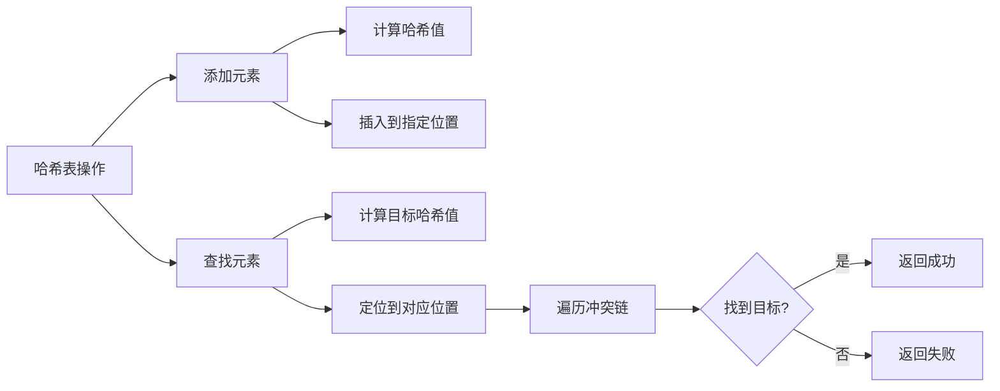

| 题型分类 | 题目 |
| --- | --- |
| 理论基础 | [哈希表理论基础](#哈希表理论基础) |
| 数组哈希 | [242 有效的字母异位词](#242有效的字母异位词) |
| 数组哈希 | [383 赎金信](#383赎金信) |
| 哈希集合 | [349 两个数组的交集](#349两个数组的交集) |
| 哈希表/快慢指针 | [202 快乐数](#202快乐数) |
| 哈希表 | [1 两数之和](#1两数之和) |
| 哈希表 | [454 四数相加2](#454四数相加2) |
| 排序/双指针 | [15 三数之和](#15三数之和) |
| 排序/双指针 | [18 四数之和](#18四数之和) |

## 哈希表理论基础

哈希表是根据**关键码的值**而直接进行访问的数据结构
直白来讲其实数组就是一张哈希表：哈希表中关键码就是数组的索引下标，然后通过下标直接访问数组中的元素

哈希表能解决什么问题呢，**一般哈希表都是用来快速判断一个元素是否出现集合里。**
例如要查询一个名字是否在这所学校里。
要枚举的话时间复杂度是O(n)，但如果使用哈希表的话， 只需要O(1)就可以做到。
我们只需要初始化把这所学校里学生的名字都存在哈希表里，在查询的时候通过索引直接就可以知道这位同学在不在这所学校里了。

### 用C语言演示哈希表原理
先介绍一下字符串中的常用函数及其头文件：
<string.h>头文件包含对字符串的操作的函数，在哈希表中常用的有：
- `strcpy(dest, src)` - string copy，把src的值复制到dest中
- `strcmp(a, b)` - string compare，对比二者，相同的话**输出是0**

以下是一个Mermaid流程图，概述哈希表的基本结构

对于初学者来说，重点是理解哈希表的核心思想，而不是完全掌握实现细节。下面的代码展示了底层原理，实际开发中可以直接使用现成的哈希表实现（如各种编程语言提供的内置字典、映射等）。关键要理解：
- 哈希函数如何将键映射到索引
- 冲突处理机制
- 时间复杂度优势

```c
#include <stdio.h>
#include <string.h>
#include <stdlib.h>

#define TABLE_SIZE 100  // 哈希表的总容量，就像有100个抽屉

// 定义哈希表节点结构体 - 就像一个装学生姓名的小盒子
typedef struct HashNode {
    char name[50];             // 存储学生姓名的空间
    struct HashNode* next;     // 如果多个学生名映射到同一个位置，就用链表连接起来，下面会讲
} HashNode;

// 全局哈希表 - 就像一个有100个抽屉的大柜子
HashNode* hash_table[TABLE_SIZE] = {NULL};  // 初始化为NULL，表示所有抽屉都是空的

// 哈希函数 - 就像一个神奇的计算器，输入姓名，输出应该存到哪个抽屉编号
unsigned int hash(const char* str) {
    unsigned int hash_value = 0;  // 初始哈希值
    
    // 对字符串中的每个字符进行计算
    while (*str) {                // 当字符串还有字符时循环
        hash_value = hash_value * 31 + *str;  // 这是计算哈希值的一种方法，*31是为了减少冲突
        str++;                    // 移动到下一个字符
    }
    
    // 将大数字压缩到抽屉范围之内（比如结果是157，但我们只有100个抽屉）
    // 所以用取余运算符 % 来确保结果在0-99之间
    return hash_value % TABLE_SIZE;  
}

// 往哈希表中添加学生姓名
void add_student(const char* name) {
    // 步骤1：先用哈希函数算出这个姓名应该放在哪个抽屉
    unsigned int index = hash(name);  // 返回0-99之间的抽屉编号
    
    // 步骤2：创建一个新的小盒子来装这个姓名
    HashNode* new_node = malloc(sizeof(HashNode));  // 在内存中申请空间
    strcpy(new_node->name, name);                   // 把姓名复制到盒子里
    new_node->next = hash_table[index];             // 把盒子连接到现有链表的开头
    hash_table[index] = new_node;                   // 更新抽屉指向新的盒子
}

// 在哈希表中查找学生
int find_student_hash(const char* name) {
    // 步骤1：用同样的哈希函数算出应该去哪个抽屉找
    unsigned int index = hash(name);  // 计算这个姓名对应的抽屉号
    
    // 步骤2：去那个抽屉里找
    HashNode* current = hash_table[index];  // 获取抽屉里的第一个盒子
    
    // 步骤3：如果抽屉里有东西（不是NULL），就开始逐个比较
    while (current != NULL) {          // 只要还有盒子可以查看
        if (strcmp(current->name, name) == 0) {  // 比较当前盒子的学生名和目标名字
            return 1;  // 找到了！返回1表示成功
        }
        current = current->next;         // 检查链表的下一个盒子
    }
    
    return 0;  // 遍历完了都没找到，返回0表示失败
}

int main() {
    // 使用示例：
    // 先把学校里的所有学生名添加到哈希表中
    add_student("张三");
    add_student("李四");  
    add_student("王五");
    
    // 然后就可以快速查找了
    if (find_student_hash("李四")) {      // 这行代码就是关键！
        printf("通过哈希表找到了李四\n");  // O(1)时间就能找到，非常快！
    } else {
        printf("通过哈希表没找到李四\n");
    }
    
    // 清理内存，释放之前申请的空间
    for (int i = 0; i < TABLE_SIZE; i++) {
        HashNode* current = hash_table[i];
        while (current != NULL) {
            HashNode* temp = current;      // 保存当前节点
            current = current->next;       // 移动到下一个
            free(temp);                    // 释放当前节点的内存
        }
    }
    
    return 0;
}
```

**核心原理解释：**
想象有一个巨大的抽屉柜，有100个抽屉（TABLE_SIZE=100）：

1. **哈希函数**就像一个秘书，你告诉他"张三"这个名字，他就能告诉你"张三"应该放在第7号抽屉里
2. **添加姓名**：先算出应该放哪个抽屉，然后把姓名放进去
3. **查找姓名**：同样用秘书帮忙算出应该去哪个抽屉，然后直接打开抽屉看有没有就行了
这样就不需要在整个学校里一个个找学生了，直接找到对应的抽屉即可，所以时间复杂度是O(1)！

**关于冲突处理：** 如果不同的名字被分配到同一个抽屉，就用链表把它们连起来，然后遍历一个链表查询。
将学生姓名映射到哈希表上就涉及到了**hash function ，也就是哈希函数**。
### 哈希函数
哈希函数，把学生的姓名直接映射为哈希表上的索引，然后就可以通过查询索引下标快速知道这位同学是否在这所学校里了。
如下图所示，通过hashCode把名字转化为数值，一般hashcode是通过特定编码方式，可以将其他数据格式转化为不同的数值，这样就把学生名字映射为哈希表上的索引数字了。

如果hashCode得到的数值大于 哈希表的大小了，也就是大于tableSize了，怎么办呢？
此时为了保证映射出来的索引数值都落在哈希表上，我们会在再次对数值做一个取模的操作，这样我们就保证了学生姓名一定可以映射到哈希表上了。

此时问题又来了，哈希表我们刚刚说过，就是一个数组。
如果学生的数量大于哈希表的大小怎么办，此时就算哈希函数计算的再均匀，也避免不了会有几位学生的名字同时映射到哈希表 同一个索引下标的位置。
接下来**哈希碰撞**登场
### 哈希碰撞
小李和小王都映射到了索引下标 1 的位置，**这一现象叫做哈希碰撞**。如图：

一般哈希碰撞有两种解决方法， 拉链法和线性探测法。

#### 拉链法
发生冲突的元素都被存储在链表中。 这样我们就可以通过索引找到小李和小王了

（数据规模是dataSize， 哈希表的大小为tableSize）
拉链法就是要选择适当的哈希表的大小，这样既不会因为数组空值而浪费大量内存，也不会因为链表太长而在查找上浪费太多时间。
#### 线性探测法
线性探测法属于**开放寻址法**：数组的每个位置只放**一个**元素（不像拉链法一个位置能挂一串链表），冲突了就去**找下一个空位**。

举个例子（假设 tableSize=5，张三、李四、王五都算出下标 1）：

| 操作 | 位置1 | 位置2 | 位置3 |
|------|-------|-------|-------|
| 插入张三 | 张三 | | |
| 插入李四（撞位置1） | 张三 | 李四 | |
| 插入王五（撞位置1、2） | 张三 | 李四 | 王五 |

查找走同一条路线：算到下标 1，发现不是目标，就**继续往后逐个找**；一旦**遇到空位**还没找到，就说明该元素不存在——因为插入时它一定会被放在第一个空位之前，不可能藏在空位后面。

使用线性探测法，**一定要保证tableSize大于dataSize**。 我们需要依靠哈希表中的**空位**来解决碰撞问题。

例如冲突的位置，放了小李，那么就向下找一个空位放置小王的信息。所以要求tableSize一定要大于dataSize ，要不然哈希表上就没有空置的位置来存放 冲突的数据了。如图：


两个顺带了解的缺点：
- **堆积问题**：冲突的元素连续向后填充，会形成一段"连号"区域，后续新元素要探测更远才能放下，查找变慢
- **删除麻烦**：删除不能直接置空，否则会截断查找链（后面的元素会因遇到空位而被误判为不存在），通常用"标记删除"
### 总结
总结一下，**当我们遇到了要快速判断一个元素是否出现集合里的时候，就要考虑哈希法**。
但是哈希法也是**牺牲了空间换取了时间**，因为我们要使用**额外的数组，set或者是map来存放数据**，才能实现快速的查找。
如果在做面试题目的时候遇到需要判断一个元素是否出现过的场景也应该第一时间想到哈希法。

> **重要提示：** 若使用C语言实现，相较于Python、Java等高级语言有先天的劣势，因为像Set、Map这样的高级数据结构都需要自己实现。所以在学习初期，建议优先掌握如何用数组来解决哈希表相关问题，这样更符合C语言的学习曲线。至于两数之和、三数之和、四数之和这种题目，还是用双指针更方便。

> 从解题角度：需要掌握 vs 不需要掌握
> **需要掌握：**
> - 哈希表核心能力：O(1) 判断某元素是否出现过，代价是**空间换时间**
> - 三种容器的选择：**数组**（数据范围小且连续，如 26 个字母）、**set**（只判存在/去重）、**dict/map**（键值映射，如 值→下标、值→次数）
> - 什么时候想到哈希法：需要快速判断某元素是否出现在集合里
>
> **不需要掌握（刷题阶段）：**
> - 手写哈希函数（* 31、取模等）：只需知道它负责把键映射成索引、取模压缩范围即可
> - 手写哈希表：C 直接使用 uthash，Python 用内置 dict/set
> - 拉链法/线性探测法：知道是解决冲突的两种思路、概念能说清楚即可，不需要会实现

## 242有效的字母异位词

[242.有效的字母异位词](https://leetcode.cn/problems/valid-anagram/description/)

给定两个字符串 s 和 t ，编写一个函数来判断 t 是否是 s 的字母异位词。

示例 1: 输入: s = "anagram", t = "nagaram" 输出: true

示例 2: 输入: s = "rat", t = "car" 输出: false

**说明:** 你可以假设字符串只包含小写字母。字母异位词是通过重新排列不同单词或短语的字母而形成的单词或短语，并使用所有原字母一次。
### 思路
暴力的解法，两层for循环，同时还要记录字符是否重复出现，很明显时间复杂度是 $O(n^2)$

**数组其实就是一个简单哈希表**，而且这道题目中字符串只有小写字符，那么就可以定义一个数组，来记录字符串s里字符出现的次数。

定义一个数组叫做record用来记录字符串s里字符出现的次数。
需要把字符映射到数组也就是哈希表的索引下标上，**因为字符a到字符z的ASCII是26个连续的数值，所以字符a映射为下标0，相应的字符z映射为下标25。**

再遍历 字符串s的时候，**只需要将 s[i] - ‘a’ 所在的元素做+1 操作即可，并不需要记住字符a的ASCII，只要求出一个相对数值就可以了。** 这样就将字符串s中字符出现的次数，统计出来了。

那看一下如何检查字符串t中是否出现了这些字符，同样在遍历字符串t的时候，对t中出现的字符映射哈希表索引上的数值再做-1的操作。

那么最后检查一下，**record数组如果有的元素不为零0，说明字符串s和t一定是谁多了字符或者谁少了字符，return false。**

最后如果record数组所有元素都为零0，说明字符串s和t是字母异位词，return true。

时间复杂度为O(n)，空间上因为定义是的一个常量大小的辅助数组，所以空间复杂度为O(1)。
### 补充C语言知识点：字符串的一些用法
在解决此题之前，先了解一下字符串的相关操作：
#### 1. 字符串基本属性
- `strlen(str)`：获取C风格字符串长度（python是len(str)）
- `str[i]`：访问第i个字符（从0开始）（python没有）

#### 2. 字符串遍历
```c
// C风格字符串遍历
for(int i = 0; i < strlen(str); i++) {
    printf("%c\n", str[i]);
}
```

#### 3. 字符串与字符操作
- 字符可以通过ASCII码进行运算，如 `'c' - 'a'` 得到2
- 字符串本质上是字符数组，在C风格中用字符指针访问
- 可以通过 `s[i]` 直接访问字符串中特定位置的字符

#### 4. 在哈希表中的应用
- 字符可以直接作为哈希表的键值
- 通过 `s[i] - 'a'` 可以将字符映射到数组索引（适用于小写字母）
- 可用于统计字符频次、判断字符存在性等

### 题解
C:
```c
bool isAnagram(char* s, char* t) {
    int len1 = strlen(s),len2 = strlen(t);
    if(len1 != len2){
        return false;//长度不同
    }
  
    int map1[26] = {0},map2[26] = {0};//赋一个0，剩余25个也都会自动补0
    for (int i = 0; i < len1; i++) {
        // char - char = int，比如 'c'-'a' = 99-97 = 2；字符串就是char型数组，用指针访问而已，s[0]就是第一个字符
        map1[s[i] - 'a'] += 1;//这样a就是数组下标为0的
        map2[t[i] - 'a'] += 1;
    }
  
    for(int i = 0;i<26;i++){
        if(map1[i]!=map2[i]){
            return false;
        }
    }
  
    return true;
}
```

Python:
```python
class Solution:
    def isAnagram(self, s: str, t: str) -> bool:
        if len(s)!=len(t): return False
        count = [0]*26
        for letter in t:
            count[ord(letter)-ord('a')] +=1
        for letter in s:
            count[ord(letter)-ord('a')] -=1
        for i in range(0,26):
            if count[i]!= 0:return False
        return True
```
> 类似题目：[49. 字幕异位词分组](https://leetcode.cn/problems/group-anagrams/)
## 383赎金信

[383.赎金信](https://leetcode.cn/problems/ransom-note/)

给定一个赎金信 (ransom) 字符串和一个杂志(magazine)字符串，判断第一个字符串 ransom 能不能由第二个字符串 magazines 里面的字符构成。如果可以构成，返回 true ；否则返回 false。

(题目说明：为了不暴露赎金信字迹，要从杂志上搜索各个需要的字母，组成单词来表达意思。杂志字符串中的每个字符只能在赎金信字符串中使用一次。)

**注意：**
你可以假设两个字符串均只含有小写字母。
canConstruct("a", "b") -> false  
canConstruct("aa", "ab") -> false  
canConstruct("aa", "aab") -> true

### 思路
这道题目和[242.有效的字母异位词](https://programmercarl.com/0242.%E6%9C%89%E6%95%88%E7%9A%84%E5%AD%97%E6%AF%8D%E5%BC%82%E4%BD%8D%E8%AF%8D.html)很像，本题判断第一个字符串ransom能不能由第二个字符串magazines里面的字符构成。

当然用时间复杂度的$O(n^2)$的暴力枚举。也可以用哈希法，毕竟哈希表就是用来查找是否有某个元素以及对应的数量的。

题目说只有小写字母，那就是26种可能，用数组容纳。用一个长度为26的数组来记录magazine里字母出现的次数。

然后再去验证这个数组是否包含了ransom所需要的所有字母（注意，magazine 里的字母无论是种类还是数量都要大于等于 ransom）。一旦出现负数，那就是不够用了。
### 题解
注意c语言中，字符串字母其实就是数字ASCII码，比如'a'=97，所以有* magazine 的操作
```c
bool canConstruct(char* ransomNote, char* magazine) {
    int hashmap[26] = {0};
    // 对magazine中字符计数
    while (*magazine != '\0') hashmap[*magazine++ % 26]++;
    // 遍历ransomNote，对应的字符自减，小于0说明该字符magazine没有或不足够表示
    while (*ransomNote != '\0') hashmap[*ransomNote++ % 26]--;
    // 如果数组中存在负数，说明ransomNote不能由magazine里面的字符构成
    for (int i = 0; i < 26; i++) {
        if (hashmap[i] < 0) return false;
    }
    return true;
}
```

而python需要借助函数，order函数用于输出ASCII码数字编号。
```python
print(ord('a'))  # 输出 97
```
所以：
-  `ord()` 把字符变数字
-  `ord(char) - ord('a')` 把字母变 0-25 索引
-  `for char in string` 遍历字符串

```python
class Solution:
    def canConstruct(self, ransomNote: str, magazine: str) -> bool:
        if len(ransomNote)>len(magazine): return False
        count = [0]* 26
        for letter in magazine:
            count[ord(letter)-ord('a')] +=1
        for letter in ransomNote:
            count[ord(letter)-ord('a')] -=1
            if count[ord(letter)-ord('a')]<0:return False
        return True
```

## 349两个数组的交集

[349.两个数组的交集](https://leetcode.cn/problems/intersection-of-two-arrays/description/)

给定两个数组 `nums1` 和 `nums2` ，返回它们的交集 。输出结果中的每个元素一定是 **唯一** 的。我们可以 **不考虑输出结果的顺序** 。

示例 1：

输入：nums1 = [1,2,2,1], nums2 = [2,2]

输出：[2]

示例 2：

输入：nums1 = [4,9,5], nums2 = [9,4,9,8,4]

输出：[9,4]

解释：[4,9] 也是可通过的

提示：1 <= nums1.length, nums2.length <= 1000；0 <= nums1[i], nums2[i] <= 1000
### 思路
这个问题的关键是**快速查找元素是否存在**。你需要找到在两个数组中都出现过的元素。

最直观的方法是遍历一个数组，在另一个数组中逐个查找对应元素。这样时间复杂度比较高。

**哈希表的作用**：哈希表可以提供O(1)的查找时间复杂度。考虑如何利用这个特性： 
- 用一个数组的元素构建哈希表
- 遍历另一个数组时快速判断元素是否存在于哈希表中

**去重问题**：题目要求返回的结果中不能有重复元素，你需要考虑：
- 找到交集元素后，如何避免重复添加
- C语言中通常需要手动处理去重逻辑

所以思路如下：
- 创建计数数组
- 遍历num1 统计个元素的出现情况
- 遍历num2检查各个元素是否在num1出现过
- 若出现过，加入结果数组result并对record对应的清零

### 题解
C：
```c
/**
 * Note: The returned array must be malloced, assume caller calls free().
 */
int* intersection(int* nums1, int nums1Size, int* nums2, int nums2Size, int* returnSize) {
    int count[1001] = {0};//用于统计的数组，1000是题目已经限制输入数组大小不超过1000
    int lessSize = (nums1Size>nums2Size)?nums2Size:nums1Size;//返回的最小长度是二者更小的那个
    int *result = (int*)calloc(lessSize,sizeof(int));
  
    for(int i=0;i<nums1Size;i++){
        count[nums1[i]]++;//把nums1中出现的先统计一下
    }
  
    int resultIndex = 0;//返回的数组的下标
  
    //检查nums2中的元素是否在nums1出现过
    for(int i = 0;i<nums2Size;i++){
        if(count[nums2[i]]>0){//nums2中出现nums1中的元素
        result[resultIndex] = nums2[i];
        resultIndex++;
        count[nums2[i]] = 0;//既然已经写入result，为了避免重复，做一个删除操作，
        }
    }
    *returnSize = resultIndex;
    return result;
}
```

一些代码解释：
calloc vs malloc：malloc见多了，calloc是什么？`calloc` 用于动态分配一块连续的内存空间，并将该空间初始化为零。
它的函数原型是：
```c
void *calloc(size_t num, size_t size);
```
在本题题解中，意思是：分配 `lessSize` 个整型变量的空间，并将分配的空间全部初始化为 0

Python：
```python
class Solution:
    def intersection(self, nums1: List[int], nums2: List[int]) -> List[int]:
        # 因为题目限制 0 <= nums1[i], nums2[i] <= 1000
        # 所以创建长度为 1001 的布尔数组
        # 下标表示数字，值表示该数字是否在 nums1 中出现过
        exists = [False] * 1001
        
        # 第一步：标记 nums1 中出现的所有数字
        for num in nums1:
            exists[num] = True
        
        # 第二步：遍历 nums2，找出同时在 nums1 中出现的数字
        result = []
        for num in nums2:
            if exists[num]:           # 如果这个数字在 nums1 中出现过
                result.append(num)    # 加入结果
                exists[num] = False   # 重要！标记为 False，防止重复添加
        
        return result
```
投机取巧：
```python
class Solution:
    def intersection(self, nums1: List[int], nums2: List[int]) -> List[int]:
        set1 = set(nums1)
        set2 = set(nums2)
        return list(set1 & set2)# 取交集并转换成List格式输出
```

## 202快乐数

[202.快乐数](https://leetcode.cn/problems/happy-number/description/)

编写一个算法来判断一个数 n 是不是快乐数。

「快乐数」定义为：对于一个正整数，每一次将该数替换为它每个位置上的数字的平方和，然后重复这个过程直到这个数变为 1，也可能是 无限循环 但始终变不到 1。如果 可以变为  1，那么这个数就是快乐数。

如果 n 是快乐数就返回 True ；不是，则返回 False 。

**示例：**

输入：19  

输出：true  

解释：  
$1^2 + 9^2 = 82$，
$8^2 + 2^2 = 68$，
$6^2 + 8^2 = 100$，
$1^2 + 0^2 + 0^2 = 1$。

提示：$1 <= n <= 2^{31} - 1$
### 思路
首先要编写一个函数来实现快乐数的计算，方便后续循环中的调用。回顾一下c语言整除/取余的计算，这个很简单。

其次，要关注题目的要求，要么重复计算快乐数，直到成为1，要么**无限循环**但永不为1，注意这个无限循环，意思就是一定会在某几个固定的数字中循环，比如：2->4->16->37->58->89->145->42->20->4,这里就会反复出现一个4，这就是所谓的循环。可以多用几个大概率是非快乐数的数字试一试，感受一下，这就是逻辑判断的关键点，因为一旦有重复的数字，就可以用哈希表存储：第一次存储后，再次得出这个数即可判断非快乐数，而有限循环且得出1的就是快乐数。

当然，个人体感上这道题是为了用哈希表而用，快慢指针的O(1)时间复杂度优于哈希的O(logn)。

### C题解1：哈希表/哈希数组
如果n是任意无穷大的数字，那这题用一个限定大小的数组是很难的，好在题目限制了$1 <= n <= 2^{31} - 1$，n最大不能大于2的31次方，也就是10位数，一个10位数最多就是10个9，而$9999999999^2$是810，那数组就可以限制在810大小。
```c
int getSum(int n){
    int count = 0;
    while(n!=0){
        int x = n%10;//取余操作，比如81就能取出1
        n /= 10;//取整，比如81就剩8，而如果是8，就剩0，也就是最终n=0
        count += x * x;
    }
    return count;
}

bool isHappy(int n) {
    int hash[810] = {0};//全员赋0
    while(n!=1){
        n = getSum(n);//原地计算快乐数
        if(hash[n]==1){
            return false;//重复出现，返回false
        }else{
            hash[n] ++;//记录每一个快乐数
        }
    }
    return true;
}
```
### C题解2：快慢指针/双指针
```c
int getSum(int n){
    int count = 0;
    while(n!=0){
        int x = n%10;
        n /= 10;
        count += x * x;
    }
    return count;
}

bool isHappy(int n) {
    int fast = n,slow = n;
    do{
        /*  
            1、当n为快乐数时，fast和slow最后都会变为1，并保持不变，fast和slow相等
            2、当n不为快乐数时，fast和slow会在一些数内重复循环，但fast每次走两步，
               slow每次走一步，fast最终会和slow相等
            综上：fast和slow在两种情况下，最终都会相等
        */
        slow = getSum(slow);
        fast = getSum(fast);
        fast = getSum(fast);//老传统了，快指针走两步，慢指针走一步
    }while(slow!=fast);

    return fast == 1;//如果真为1，就是快乐数，返回true，反之返回false
}
```
### Python题解
```python
class Solution:
    def get_num(self,n):# 注意self参数别漏
        sum = 0
        while n>0:
            digit = n % 10
            sum += digit*digit
            n = n//10
        return sum
  
    def isHappy(self, n: int) -> bool:
        seen = set()
        while n != 1 and n not in seen:
            seen.add(n)
            n = self.get_num(n)# 需要self.调用，不加self就放在class外面当全局
        if n == 1:
            return True
        else:
            return False
```

## 1两数之和

[1.两数之和](https://leetcode.cn/problems/two-sum/description/)

给定一个整数数组 nums 和一个目标值 target，请你在该数组中找出和为目标值的那 两个 整数，并返回他们的数组下标。

你可以假设每种输入只会对应**一个答案**。但是，数组中同一个元素不能使用两遍。

**示例:**

给定 nums = [2, 7, 11, 15], target = 9

因为 nums[0] + nums[1] = 2 + 7 = 9

所以返回 [0, 1]

### 思路
如用c语言，显然不如python方便，要自己实现哈希表。
首先暴力解法肯定可以，注意一下题目要求**数组中同一个元素不能使用两遍**。但是时间复杂度为$O(n^2)$。
想要用c实现哈希表，必须使用uthash 库，这是一个c语言的有关哈希的头文件库。

**哈希法核心思路**：用空间换时间。以 **值→索引** 的映射存入哈希表，遍历时计算 `complement = target - nums[i]`，查表判断差值是否已出现——命中则 O(1) 返回两索引，未命中则将当前元素入表。整体 O(n) 时间复杂度。

### 题解
#### C暴力
```c
/**
 * Note: The returned array must be malloced, assume caller calls free().
 */
int* twoSum(int* nums, int numsSize, int target, int* returnSize) {//暴力
    *returnSize = 2;
    int *result = (int*)malloc(sizeof(int)*2);
    for(int i = 0;i<numsSize;i++){
        for(int j = i+1;j<numsSize;j++){//j = i+1，题目说了不能重复下标
            int sum = nums[i]+nums[j];
            if(sum==target){
                result[0] = i;
                result[1] = j;
                return result;
            }
        }
    }
    free(result);
    *returnSize = 0;
    return 0;
}
```

#### C哈希法
```c
//leetcode自带uthash 库

// ========== 1. 定义哈希表节点结构 ==========
typedef struct {
    int key;        // 哈希表的键：存储数组元素的值 (nums[i])
    int value;      // 哈希表的值：存储该元素在原数组中的索引 i
    UT_hash_handle hh;  // uthash 必需的句柄，用于内部链表管理
} HashNode;

// ========== 2. 两数之和主函数 ==========
int* twoSum(int* nums, int numsSize, int target, int* returnSize) {
    HashNode* hashTable = NULL;  // 初始化哈希表指针，必须设为 NULL
    HashNode* node = NULL;       // 用于临时存储查找到的节点
    
    // 遍历数组
    for (int i = 0; i < numsSize; i++) {
        int complement = target - nums[i];  // 计算需要找的另一个数
        
        // ========== 3. 查找 complement 是否在哈希表中 ==========
        // 参数：哈希表头指针, 要查找的 key 的地址, 结果存储变量
        HASH_FIND_INT(hashTable, &complement, node);
        
        if (node != NULL) {
            // 找到了！node->value 是 complement 的索引，i 是当前索引
            int* result = (int*)malloc(sizeof(int) * 2);
            result[0] = node->value;  // 先出现的数的索引
            result[1] = i;            // 当前数的索引
            *returnSize = 2;
            
            // ========== 4. 清理内存（重要！）==========
            HashNode *current, *tmp;
            HASH_ITER(hh, hashTable, current, tmp) {
                HASH_DEL(hashTable, current);  // 从哈希表删除
                free(current);                  // 释放节点内存
            }
            
            return result;
        }
        
        // ========== 5. 没找到，把当前数加入哈希表 ==========
        // 先创建新节点
        node = (HashNode*)malloc(sizeof(HashNode));
        node->key = nums[i];    // key 是数组元素的值
        node->value = i;        // value 是该元素的索引
        
        // 添加到哈希表
        // 参数：哈希表头指针, key 字段名, 要添加的节点
        HASH_ADD_INT(hashTable, key, node);
    }
    
    // 没找到答案（按题意不会发生）
    *returnSize = 0;
    return NULL;
}
```
#### Python哈希
这题可以用字典解决。
1. 创建一个空字典 `{}`，用来存"数字→下标"
2. 遍历数组，`i` 从 0 到 `len(nums)-1`：  
    a. 当前数字是 `num`  
    b. 计算补数 `complement = target - num`  
    c. 在字典里**查找** `complement` 是否存在  
    d. 如果存在，返回 `[字典中complement对应的下标, i]`  
    e. 如果不存在，把 `num` 和 `i` 存入字典
3. 循环结束还没返回，说明没有解（但题目保证有解）

**常见错误做法**：先把所有数字存入字典，再遍历查找
问题：如果有重复数字（比如 `[3, 3]`），后一个会覆盖前一个的下标，导致找不到正确结果。
**正确做法**：**边遍历边存**，保证每个数字只被用一次。

补充一些字典的常见操作，比如新增键值对

|操作|列表|字典|
|---|---|---|
|新增元素|`append()` / `insert()`|`dict[key] = value`|
|访问元素|`list[0]`（数字下标）|`dict['key']`（键）|
|修改元素|`list[0] = 10`|`dict['key'] = 10`|
|删除元素|`pop()` / `remove()`|`pop(key)` / `del dict[key]`|
|检查存在|`item in list`|`key in dict`|
另外，值得想想：键值对是用数字做键、下标做值，还是用下标做键、数字做值？
```python
class Solution:
    def twoSum(self, nums: List[int], target: int) -> List[int]:
        count = {}
        for i in range(0, len(nums)):  # 遍历全部
            complement = target - nums[i]
            if complement in count:  # 检查键是否存在
                return [count[complement], i]  # 获取补数的下标
            else:
                count[nums[i]] = i  # 用数字作键，下标作值
```

## 454四数相加2

[454.四数相加II](https://leetcode.cn/problems/4sum-ii/)

给定四个包含整数的数组列表 A , B , C , D ,计算有多少个元组 (i, j, k, l) ，使得 A[i] + B[j] + C[k] + D[l] = 0。

为了使问题简单化，所有的 A, B, C, D 具有相同的长度 N，且 0 ≤ N ≤ 500 。所有整数的范围在 $-2^{28}$ 到 $2^{28} - 1$ 之间，最终结果不会超过 $2^{31} - 1$ 。

**例如:**
输入:
- A = [ 1, 2]
- B = [-2,-1]
- C = [-1, 2]
- D = [ 0, 2]

输出:
2

**解释:**

两个元组如下:
1. (0, 0, 0, 1) -> A[0] + B[0] + C[0] + D[1] = 1 + (-2) + (-1) + 2 = 0
2. (1, 1, 0, 0) -> A[1] + B[1] + C[0] + D[0] = 2 + (-1) + (-1) + 0 = 0
### 思路
**问题本质**：从4个数组中各选一个数，四数之和为0，统计满足条件的元组数量。

**暴力枚举问题**：四层循环 O(N⁴)，N=500 时太慢。

**核心优化思路：两两配对 + 哈希表**
```
A[i] + B[j] + C[k] + D[l] = 0
→ 移项得：A[i] + B[j] = -(C[k] + D[l])
→ 只需找"互为相反数"的两组数之和
```
**具体步骤**：

| 阶段 | 操作 | 复杂度 |
|------|------|--------|
| 第一步 | 枚举 A+B 的所有可能和，存入哈希表 (key=sum, value=出现次数) | O(N²) |
| 第二步 | 枚举 C+D 的所有可能和，查找 `-(C[k]+D[l])` 在哈希表中的出现次数 | O(N²) |
| 第三步 | 累加所有匹配次数 | - |

**时间复杂度**：O(N²)  

**空间复杂度**：O(N²)（哈希表最多存 N² 个不同的和）

---
C代码中使用的是 **uthash** 库（C语言第三方哈希表实现）：
- `HASH_ADD_INT`：插入到哈希表
- `HASH_FIND_INT`：按整数键查找
- `HASH_FIND_INT` 返回 NULL 表示未找到

### C题解
```c
typedef struct {
    int key;
    int count;
    UT_hash_handle hh;
} HashItem;
  
int fourSumCount(int* nums1, int n1, int* nums2, int n2,
                 int* nums3, int n3, int* nums4, int n4) {
    HashItem *hashTable = NULL, *item, *tmp;
    // 插入A+B
    for (int i = 0; i < n1; i++)
        for (int j = 0; j < n2; j++) {
            int sum = nums1[i] + nums2[j];
            HASH_FIND_INT(hashTable, &sum, item);
            if (!item) {
                item = malloc(sizeof(HashItem));
                item->key = sum; item->count = 1;
                HASH_ADD_INT(hashTable, key, item);
            } else {
                item->count++;
            }
        }
    int ans = 0;
    // 查找-(C+D)
    for (int i = 0; i < n3; i++)
        for (int j = 0; j < n4; j++) {
            int target = -(nums3[i] + nums4[j]);
            HASH_FIND_INT(hashTable, &target, item);
            if (item) ans += item->count;
        }
    // 释放内存...
    return ans;
}
```

### Python题解
不需要实现数据结构，用字典。
```python
class Solution(object):
    def fourSumCount(self, nums1, nums2, nums3, nums4):
        # 使用字典存储nums1和nums2中的元素及其和
        hashmap = dict()
        for n1 in nums1:
            for n2 in nums2:
                if n1 + n2 in hashmap:
                    hashmap[n1+n2] += 1
                else:
                    hashmap[n1+n2] = 1
        
        # 如果 -(n1+n2) 存在于nums3和nums4, 存入结果
        count = 0
        for n3 in nums3:
            for n4 in nums4:
                key = - n3 - n4
                if key in hashmap:
                    count += hashmap[key]
        return count
```

## 15三数之和

[15.三数之和](https://leetcode.cn/problems/3sum/)

给你一个整数数组 `nums` ，判断是否存在三元组 `[nums[i], nums[j], nums[k]]` 满足 `i != j`、`i != k` 且 `j != k` ，同时还满足 `nums[i] + nums[j] + nums[k] == 0` 。请你返回所有和为 `0` 且不重复的三元组。

注意：答案中不可以包含重复的三元组。

示例 1：

输入：nums = [-1,0,1,2,-1,-4]

输出：[ [-1,-1,2],[-1,0,1] ]

解释：

nums[0] + nums[1] + nums[2] = (-1) + 0 + 1 = 0 。

nums[1] + nums[2] + nums[4] = 0 + 1 + (-1) = 0 。

nums[0] + nums[3] + nums[4] = (-1) + 2 + (-1) = 0 。

不同的三元组是 [-1,0,1] 和 [-1,-1,2] 。

注意，输出的顺序和三元组的顺序并不重要。

示例 2：

输入：nums = [0,1,1]

输出：[]

解释：唯一可能的三元组和不为 0 。

示例 3：

输入：nums = [0,0,0]

输出：[ [0,0,0] ]

解释：唯一可能的三元组和为 0 。

备注：3 <= nums.length <= 3000
### 思路
其实这道题哈希法很麻烦，c语言这种没有现成的hashmap的语言就更难了，不推荐用哈希法。
这题推荐用双指针法。

双指针（理论上有三个指针）思路如下：

首先将数组排序，然后有一层for循环，i从下标0的地方开始，同时定一个下标left 定义在i+1的位置上，定义下标right 在数组结尾的位置上。

依然还是在数组中找到 abc 使得a + b +c =0，我们这里相当于 a = nums[i]，b = nums[left]，c = nums[right]。

接下来如何移动left 和right呢， 如果nums[i] + nums[left] + nums[right] > 0 就说明 此时三数之和大了，因为数组是排序后了，所以right下标就应该向左移动，这样才能让三数之和小一些。

如果 nums[i] + nums[left] + nums[right] < 0 说明 此时 三数之和小了，left 就向右移动，才能让三数之和大一些，直到left与right相遇为止。

上面讲完了探索的策略，现在讨论一下要如何返回结果：
可以看到题目中有一个输出：[ [-1,-1,2],[-1,0,1] ]，也有一个[ [0,0,0] ]，显然结果是需要malloc的，并且是一个动态的二维数组，大小是n(行) × 3（列），每个小数组的大小都是3，因为是三元组嘛。
### 题解
C三指针：
```c
/**
 * Return an array of arrays of size *returnSize.
 * The sizes of the arrays are returned as *returnColumnSizes array.
 * Note: Both returned array and *columnSizes array must be malloced, assume caller calls free().
 */
 //qsort辅助cmp函数
int cmp(const void* ptr1, const void* ptr2) {
    return *((int*)ptr1) > *((int*)ptr2);
}

int** threeSum(int* nums, int numsSize, int* returnSize, int** returnColumnSizes) {
    //开辟ans数组空间
    int **ans = (int**)malloc(sizeof(int*) * 18000);
    int ansTop = 0;
    //若传入nums数组大小小于3，则需要返回数组大小为0
    if(numsSize < 3) {
        *returnSize = 0;
        return 0;
    }
    //对nums数组进行排序
    qsort(nums, numsSize, sizeof(int), cmp);
    
    int i;
    //用for循环遍历数组，结束条件为i < numsSize - 2(要预留左右指针的位置)
    for(i = 0; i < numsSize - 2; i++) {
        //若当前i指向元素>0，则代表left和right以及i的和大于0。直接break
        if(nums[i] > 0)
            break;
        //去重：i > 0 && nums[i] == nums[i-1]，如果当前数和前一个数一样，就跳过
        if(i > 0 && nums[i] == nums[i-1])
            continue;
        //定义左指针和右指针
        int left = i + 1;
        int right = numsSize - 1;
        //当右指针比左指针大时进行循环
        while(right > left) {
            //求出三数之和
            int sum = nums[right] + nums[left] + nums[i];
            //若和小于0，则左指针+1（因为左指针右边的数比当前所指元素大）
            if(sum < 0)
                left++;
            //若和大于0，则将右指针-1
            else if(sum > 0)
                right--;
            //若和等于0
            else {
                //开辟一个大小为3的数组空间，存入nums[i], nums[left]和nums[right]
                int* arr = (int*)malloc(sizeof(int) * 3);
                arr[0] = nums[i];
                arr[1] = nums[left];
                arr[2] = nums[right];
                //将开辟数组存入ans中
                ans[ansTop++] = arr;
                //去重
                while(right > left && nums[right] == nums[right - 1])
                    right--;
                while(left < right && nums[left] == nums[left + 1])
                    left++;
                //更新左右指针
                left++;
                right--;
            }
        }
    }
  
    //设定返回的数组大小
    *returnSize = ansTop;//解引用一次，可以赋值int类型的数字给它
    *returnColumnSizes = (int*)malloc(sizeof(int) * ansTop);//解引用一次，可以赋值int*类型的指针
    for(int z = 0; z < ansTop; z++) {
        (*returnColumnSizes)[z] = 3;
    }
    return ans;
}
```

```python
class Solution:
    def threeSum(self, nums: list[int]) -> list[list[int]]:
        nums.sort()
        res = []
        for i in range(len(nums)):
            if nums[i] > 0:
                break
            if i > 0 and nums[i] == nums[i-1]:
                continue
            left, right = i + 1, len(nums) - 1
            while left < right:
                s = nums[i] + nums[left] + nums[right]
                if s < 0:
                    left += 1
                elif s > 0:
                    right -= 1
                else:
                    res.append([nums[i], nums[left], nums[right]])
                    left += 1
                    right -= 1
                    while left < right and nums[left] == nums[left - 1]:
                        left += 1
                    while left < right and nums[right] == nums[right + 1]:
                        right -= 1
        return res
```

## 18四数之和
[18. 四数之和](https://leetcode.cn/problems/4sum/description/)

给你一个由 `n` 个整数组成的数组 `nums` ，和一个目标值 `target` 。请你找出并返回满足下述全部条件且**不重复**的四元组 `[nums[a], nums[b], nums[c], nums[d]]` （若两个四元组元素一一对应，则认为两个四元组重复）：
- `0 <= a, b, c, d < n`
- `a`、`b`、`c` 和 `d` **互不相同**
- `nums[a] + nums[b] + nums[c] + nums[d] == target`

你可以按 **任意顺序** 返回答案 。

示例 1：

输入：nums = [1,0,-1,0,-2,2], target = 0

输出：[-2,-1,1,2],[-2,0,0,2],[-1,0,0,1]

示例 2：

输入：nums = [2,2,2,2,2], target = 8

输出：[ [2,2,2,2] ]
### 思路
和[15.三数之和](https://programmercarl.com/0015.%E4%B8%89%E6%95%B0%E4%B9%8B%E5%92%8C.html)是一个思路，都是使用双指针法, 基本解法就是在[15.三数之和](https://programmercarl.com/0015.%E4%B8%89%E6%95%B0%E4%B9%8B%E5%92%8C.html)的基础上再套一层for循环。

不同点：三数之和 可以通过 `nums[i] > 0` 就返回了，因为 0 已经是确定的数了，四数之和这道题目 target是任意值。比如：数组是`[-4, -3, -2, -1]`，`target`是`-10`，不能因为`-4 > -10`而跳过。但是我们依旧可以去做剪枝，逻辑变成`nums[k] > target && (nums[k] >=0 || target >= 0)`就可以了。

四数之和的双指针解法是两层for循环nums[k] + nums[i]为确定值，依然是循环内有left和right下标作为双指针，找出nums[k] + nums[i] + nums[left] + nums[right] == target的情况，三数之和的时间复杂度是O(n^2)，四数之和的时间复杂度是O(n^3) 。
### 题解
```c
/* qsort */
static int cmp(const void* arg1, const void* arg2) {
    int a = *(int *)arg1;
    int b = *(int *)arg2;
    return (a > b);
}

int** fourSum(int* nums, int numsSize, int target, int* returnSize, int** returnColumnSizes) {

    /* 对nums数组进行排序 */
    qsort(nums, numsSize, sizeof(int), cmp);

    int **res = (int **)malloc(sizeof(int *) * 40000);
    int index = 0;

    /* k */
    for (int k = 0; k < numsSize - 3; k++) { /* 第一级 */

        /* k剪枝 */
        if ((nums[k] > target) && (nums[k] >= 0)) {
            break;
        }
        /* k去重 */
        if ((k > 0) && (nums[k] == nums[k - 1])) {
            continue;
        }

        /* i */
        for (int i = k + 1; i < numsSize - 2; i++) { /* 第二级 */

            /* i剪枝 */
            if ((nums[k] + nums[i] > target) && (nums[i] >= 0)) {
                break;
            }
            /* i去重 */
            if ((i > (k + 1)) && (nums[i] == nums[i - 1])) {
                continue;
            }

            /* left and right */
            int left = i + 1;
            int right = numsSize - 1;

            while (left < right) {

                /* 防止大数溢出 */
                long long val = (long long)nums[k] + nums[i] + nums[left] + nums[right];
                if (val > target) {
                    right--;
                } else if (val < target) {
                    left++;
                } else {
                    int *res_tmp = (int *)malloc(sizeof(int) * 4);
                    res_tmp[0] = nums[k];
                    res_tmp[1] = nums[i];
                    res_tmp[2] = nums[left];
                    res_tmp[3] = nums[right];
                    res[index++] = res_tmp;
                    
                    /* right去重 */
                    while ((right > left) && (nums[right] == nums[right - 1])) {
                        right--;
                    }
                    /* left去重 */
                    while ((left < right) && (nums[left] == nums[left + 1])) {
                        left++;
                    }

                    /* 更新right与left */
                    left++, right--;
                }
            }
        }
    }

    /* 返回值处理 */
    *returnSize = index;

    int *column = (int *)malloc(sizeof(int) * index);
    for (int i = 0; i < index; i++) {
        column[i] = 4;
    }
    *returnColumnSizes = column;
    return res;
}
```
